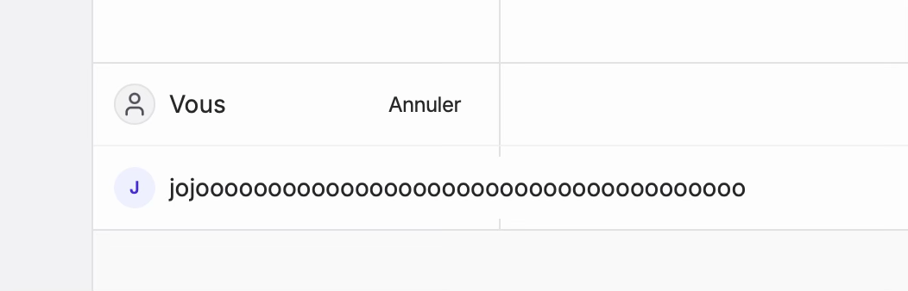
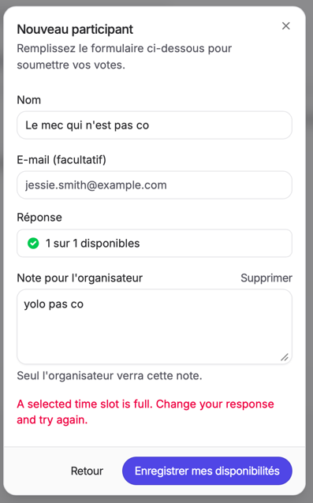
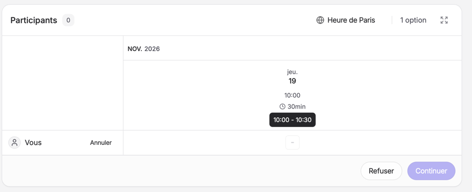

# Déploiement de Rallly avec Authentik

La stack construit notre fork depuis le sous-module `rallly` et lance Authentik
(serveur et worker) avec une base PostgreSQL dédiée. Traefik est le point d'entrée
HTTP commun aux deux applications. Les données sont conservées dans des volumes Docker.

Le [scan commenté de l'image Docker Rallly](docs/scan-image-docker.md) présente
les résultats du 19 novembre 2026, les corrections à prévoir et les limites
retenues, avec les preuves brutes et un commentaire pour la soutenance.

Avec Docker et Docker Compose 2.24 ou supérieur :

```shell
git submodule update --init --recursive
# Uniquement si .env n'existe pas encore :
cp .env.example .env
chmod 600 .env
```

Renseigner les quatre secrets vides du `.env` avec les résultats de ces commandes
(une commande par variable, conserver ces secrets après initialisation) :

```shell
openssl rand -hex 32  # RALLLY_SECRET
openssl rand -hex 32  # AUTHENTIK_DB_PASSWORD
openssl rand -hex 60  # AUTHENTIK_SECRET_KEY
openssl rand -hex 32  # OIDC_CLIENT_SECRET
```

Le `.env` local est déjà renseigné avec des secrets générés. Le mot de passe de la
base Rallly reste `postgres` pour conserver la compatibilité avec un volume existant ;
pour une nouvelle installation, le remplacer par une valeur hexadécimale.
Modifier un mot de passe dans `.env` ne change pas celui d'une base déjà initialisée.

```shell
docker compose config --quiet
docker compose up -d --build
```

- Rallly : <http://rallly.localhost>
- Authentik : <http://rallly.localhost/authentik/>
- Administration Authentik : <http://rallly.localhost/authentik/if/admin/>

Seul Traefik publie un port sur la machine (`TRAEFIK_HTTP_PORT=80` par défaut).
Les applications et PostgreSQL sont accessibles sur leurs réseaux Docker respectifs.
Les anciens accès directs sur les ports 3000, 9000, 9443 et 5450 sont supprimés.
La configuration locale utilise HTTP ; aucun certificat TLS n'est configuré.

Les routes sont définies dans `docker/traefik/dynamic/routes.yaml` avec le
[file provider de Traefik](https://doc.traefik.io/traefik/reference/routing-configuration/other-providers/file/).
Le routage utilise uniquement les chemins : `/authentik/` vers Authentik et `/` vers
Rallly, quel que soit le nom de domaine demandé. Le préfixe Authentik est conservé
jusqu'au serveur (`AUTHENTIK_WEB__PATH=/authentik/`). Aucun accès au socket Docker
n'est requis.

`PUBLIC_BASE_URL` dans `.env` définit l'origine commune, sans chemin ni slash final.
Elle est utilisée pour Rallly, la découverte OIDC, les liens Authentik et le callback.
Traefik transmet cette origine canonique, y compris le protocole HTTPS quand un tunnel
termine TLS avant de joindre le port HTTP local.

Au premier accès, ouvrir <http://rallly.localhost/authentik/if/flow/initial-setup/>
et définir le mot de passe du compte `akadmin`.
Son adresse mail initiale est définie par `AUTHENTIK_BOOTSTRAP_EMAIL` ; chaque
utilisateur doit avoir une adresse mail renseignée pour se connecter à Rallly.

L'origine publique, le port HTTP local, les versions et la base Authentik se règlent dans `.env`.
Cette version utilise PostgreSQL sans Redis. Le worker n'a pas accès au socket Docker ;
les éventuels outposts externes doivent être déployés manuellement.

La connexion par mail de Rallly est désactivée (`EMAIL_LOGIN_ENABLED=false`).
Rallly redirige automatiquement vers Authentik. Le blueprint monté dans le worker
crée l'application OIDC `rallly`, son fournisseur et les scopes `openid profile email`.
Le client ID et le secret sont partagés via `.env` ; aucune saisie manuelle de ces
valeurs dans Authentik n'est nécessaire. Rallly attend que le fournisseur soit prêt.

Le même blueprint crée deux groupes : `rallly-allowed` autorise la connexion SSO
à Rallly, et `rallly-denied` la refuse. Le refus est prioritaire si un compte appartient
aux deux groupes. Les administrateurs Authentik conservent leur accès sauf s'ils
appartiennent à `rallly-denied`. Les autres comptes sans groupe autorisé sont refusés.
Gérer les membres depuis **Directory > Groups** dans l'administration Authentik.

Le nom local `rallly.localhost` pointe vers la boucle locale dans les navigateurs
compatibles avec `.localhost`, et vers Traefik dans Docker pour les échanges OIDC.
Si le navigateur ne le résout pas, ajouter `127.0.0.1 rallly.localhost` au fichier hosts.
Ce nom ne sert pas à sélectionner une application : les deux applications partagent
la même origine et sont distinguées par leur chemin.

Pour appliquer l'origine locale et synchroniser les conteneurs, l'URL système
Authentik et le callback du fournisseur existant :

```shell
python3 scripts/set-public-url.py http://rallly.localhost
```

Pour utiliser le port 8088, définir `TRAEFIK_HTTP_PORT=8088`, puis exécuter
`python3 scripts/set-public-url.py http://rallly.localhost:8088`.

Voir [la configuration et la vérification OIDC](docs/authentik-oidc.md).
Les paramètres SMTP facultatifs de Rallly peuvent rester dans `rallly/apps/web/.env`.

```shell
docker compose ps
docker compose logs -f traefik authentik_server authentik_worker
docker compose down  # conserve les données
```

Le workflow `.github/workflows/ci.yml` vérifie le dépôt puis construit l'image Docker
du fork sur les push et les pull requests vers `main`. Il peut aussi être lancé
manuellement depuis GitHub Actions. Le checkout initialise récursivement les
sous-modules à la révision enregistrée dans Infra.

Le build utilise `rallly/apps/web/Dockerfile`, le contexte `rallly` et
`SELF_HOSTED=true`, pour une image Linux amd64 nommée `rallly-fork:<commit Infra>`.
Les couches sont mises en cache dans GitHub Actions. L'image est chargée dans le
runner pour la durée du job ; elle n'est pas publiée dans un registre.

## Features ajoutées
- **Feature libre** : (UI/UX) correction de l'alignement de la zone d'entrée du code de vérification de l'adresse email et de l'overlapping de certains champs
- **Catalogue** — quota de votes « Oui » par créneau et blocage des votes sur les créneaux passés.
- **Feature libre** — afficher le nom complet d’un participant au survol dans le tableau des votes.
- **Amélioration complémentaire** — centrer les cases de saisie du code de vérification reçu par e-mail.

Voir [les scénarios de démonstration et les captures](docs/features.md).

## Hébergement de l'instance de test pour démo

Prérequis : Python 3.10 ou supérieur, Docker démarré, `.env` renseigné et un compte
ngrok. Installer et configurer ngrok une fois sur le Mac :

```shell
brew install ngrok
ngrok config add-authtoken TON_TOKEN
```

Le jeton est stocké dans la configuration utilisateur de ngrok.
Une seule commande lance ensuite le tunnel partagé et configure les deux applications :

```shell
python3 scripts/start-tunnel.py
```

Le script démarre la stack, lit le port de Traefik et lance `ngrok http` avec des
journaux JSON. Il attend l'événement de démarrage du tunnel pour récupérer son URL
HTTPS, puis met à jour `PUBLIC_BASE_URL`. L'agent ngrok se connecte en TLS sur
443/TCP. Le script synchronise les conteneurs,
l'URL système Authentik et le callback OIDC, puis vérifie les deux applications
via le tunnel avant d'afficher leurs liens :

- Rallly : `https://xxxx.ngrok-free.app/`
- Authentik : `https://xxxx.ngrok-free.app/authentik/`
- Administration : `https://xxxx.ngrok-free.app/authentik/if/admin/`
- Callback OIDC : `https://xxxx.ngrok-free.app/api/auth/callback/oidc`

Garder le terminal ouvert pendant la démo. **Ctrl+C** arrête le processus ngrok
et restaure automatiquement l'origine précédente dans `.env`, les conteneurs et
Authentik. Les secrets et les appartenances aux groupes sont conservés. En cas
d'échec de configuration, le script arrête aussi le tunnel et tente cette restauration.

Pour afficher les journaux du tunnel ou augmenter le délai d'attente de 90 secondes :

```shell
python3 scripts/start-tunnel.py --verbose --timeout 120
```

Pour tester la vérification par code email avec Mailpit :

```shell
python3 scripts/start-tunnel.py --email-login
```

Cette option ajoute `docker-compose.email.yaml`, active le formulaire email de
Rallly et configure son SMTP vers Mailpit. Authentik reste proposé sur la page
de connexion. Saisir une adresse de test, par exemple `demo@example.com`, puis
ouvrir [Mailpit](http://localhost:8025) sur le Mac pour récupérer le code et le
recopier dans Rallly. Les emails sont capturés localement ; l'interface Mailpit
est liée à `127.0.0.1` et n'est pas publiée par ngrok. La connexion email permet
de tester Rallly directement, sans passer par les groupes d'accès Authentik.

**Ctrl+C** rétablit le mode de connexion défini dans `.env`. Mailpit reste
disponible pour consulter les emails de la démo. Pour le supprimer ensuite :

```shell
docker compose -f docker-compose.yaml -f docker-compose.email.yaml rm -sf mailpit
```

Le même mode fonctionne sans tunnel :

```shell
python3 scripts/set-public-url.py http://rallly.localhost --email-login
```

Revenir au mode habituel avec `python3 scripts/set-public-url.py http://rallly.localhost`.

Si un tunnel a déjà été lancé manuellement avec
`ngrok http 80`, son URL peut toujours être appliquée
avec `python3 scripts/set-public-url.py https://xxxx.ngrok-free.app`.

Les tests du lanceur ne créent aucun tunnel public et ne modifient pas Docker :

```shell
python3 -B scripts/test_start_tunnel.py
```

# Features

- Affichage du nom complet au survol
  
- Refus d’un vote lorsque le quota est atteint
  
- Blocage des votes sur les créneaux passés
  
